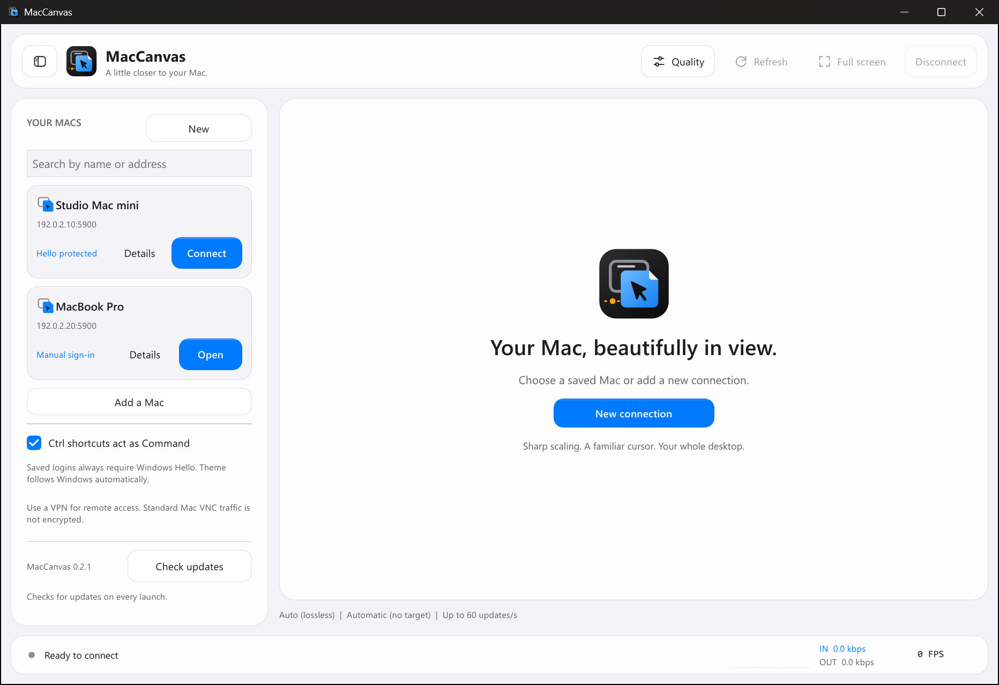

# MacCanvas

**Your Mac. Your Windows screen.**

A lightweight Windows viewer for macOS Screen Sharing.
One portable executable. No extra DLLs, server, or subscription.

<picture>
  <source media="(prefers-color-scheme: dark)" srcset="docs/images/connections-dark.png">
  
</picture>

*The app follows the Windows theme. Screenshot uses demonstration machines.*

## Features

- **Sharp scaling:** fit a 4K desktop to your screen without changing the Mac's resolution.
- **Visible cursor:** keep your normal Windows pointer and accessibility size.
- **Easy connections:** searchable Mac list, quick connect, and an animated, collapsible sidebar.
- **Protected logins:** Windows Credential Manager storage; **Windows Hello is mandatory for every saved login**. Saved passwords cannot be displayed.
- **Live statistics:** animated download/upload history, automatic kbps/Mbps units, and an optional FPS counter.
- **Quality controls:** compression, JPEG quality, maximum update rate, and a manual bandwidth target, with an in-app comparison guide.
- **Familiar controls:** mouse, keyboard, scrolling, full screen, and optional Ctrl-to-Command shortcuts.
- **Glass-inspired appearance:** black/charcoal in dark mode, Apple-style whites and grays in light mode, and system-blue controls. Follows Windows appearance preferences.
- **Easy updates:** checks the official release on launch and prompts before a verified, one-click update and restart.

## Install

**Windows 10/11 x64**, PowerShell 5.1+. Run as your normal user:

```powershell
irm https://raw.githubusercontent.com/false00/maccanvas/main/install.ps1 | iex
```

Run the same command to update. The installer verifies SHA-256 digests and creates
a Start-menu shortcut. Prefer portable? Download `MacCanvas-windows-x64.exe`
from [Releases](https://github.com/false00/maccanvas/releases/latest) and run it.

When a newer version is available, choose **Update & restart** or **Later**.
Disconnect first if a Mac session is active. The app verifies the download and
updates its own executable without changing saved Macs or credentials.
Its folder must be writable. **Check updates** in the sidebar retries the check;
the installer command remains available for manual updates.

**Unsigned application:** only run downloads and remote scripts you trust.
[Read the installer](install.ps1) first. Checksums do not establish publisher trust
or bypass Windows application-control policies.

## Connect

1. On the Mac, enable **System Settings → General → Sharing → Screen Sharing**
   and allow your macOS account.
2. Select **New connection**. Enter the Mac's name, IP/VPN address, and port `5900`.
3. Choose **Mac account** and enter its username/password. Select **Connect to Mac**.
4. To reconnect with Hello, enable **Save login in Credential Manager**.
   Credentials are saved only after a successful login.

**VNC password** is for the separate password configured in Screen Sharing,
not the Mac account password. If necessary, use your macOS short username.

Use a VPN for internet access. **Never expose port 5900 publicly.** Standard
Mac VNC screen and input traffic is not encrypted, even with Mac account login.

## Quality and statistics

Open **Quality** before or during a connection. Defaults are **Auto lossless,
compression 6, no bandwidth target, and a 60-update/s maximum**.

Supported methods: **ZRLE, Tight, Tight + JPEG, Hextile, Zlib, RRE, CoRRE, Raw**,
plus CopyRect. The in-app guide explains CPU cost, image quality, and illustrative
bandwidth ranges. The Mac can choose a fallback or ignore compression hints.
Proprietary Apple high-performance codecs and H.264 are not supported.

A bandwidth target paces screen requests; **it is not a guaranteed bitrate cap**.
Bursts can exceed it. Keyboard and mouse input are not throttled.
Traffic measures RFB bytes, excluding TCP/VPN overhead. FPS counts unique desktop
images submitted for display, not monitor refreshes; idle screens can read 0 FPS.

## Saved-login privacy

Passwords never enter profile files or a saved-password display field.
Every [saved-login attempt](docs/images/saved-login.png) requires a fresh Hello approval. If Hello is unavailable
or cancelled, the app neither reads the saved password nor opens the connection.
You may instead enter credentials manually; this does not unlock the saved login.

Delete a Mac in the app to remove its saved credential. Saved logins are tied to
their original address. Hello is an app approval gate, not extra vault encryption:
other software running as your Windows user may access generic Windows credentials.

## Remove

Close MacCanvas, then:

```powershell
& ([scriptblock]::Create((irm https://raw.githubusercontent.com/false00/maccanvas/main/install.ps1))) -Uninstall
```

The managed application and shortcut are removed. Profiles and credentials are
preserved; delete saved Macs in the app first to remove their logins.
For a portable copy, delete the executable.

## Build and credits

Install rustup and Visual Studio C++ Build Tools, then:

```powershell
cargo test --locked
cargo clippy --all-targets --locked -- -D warnings
cargo build --release --locked
```

The pinned toolchain builds `target\x86_64-pc-windows-msvc\release\maccanvas.exe`.
Rust + Slint, software rendering, static Microsoft C runtime.
Windows releases are built and tested in GitHub Actions.

An independent project inspired by [TigerVNC](https://tigervnc.org/).
Credit to the TigerVNC team, RealVNC, TightVNC, and the original VNC authors.
No TigerVNC C++ code is embedded. The original logo depicts a remote screen
becoming a local canvas.

**GPL-3.0-or-later.** Dependency credits: [THIRD_PARTY_NOTICES.txt](THIRD_PARTY_NOTICES.txt)
or `--licenses`.
